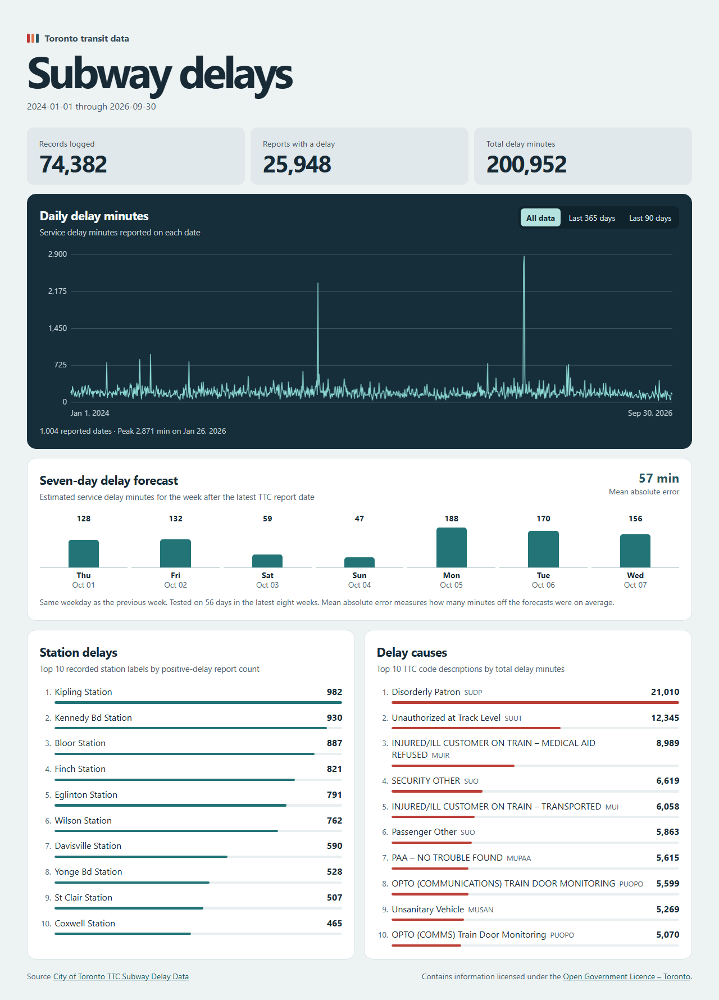

# Toronto TTC Subway Delay Pipeline

## Transit data dashboard



## How it works

- **Python and PostgreSQL** load the TTC’s 2024 archive and refresh the City’s 2025-onward feed. Both imports can be rerun safely.
- **dbt** combines the two feeds, tests the totals, and builds SQL views for trends and rankings.
- **Airflow** runs the refresh and then `dbt build` every Monday at 9 a.m. Toronto time when the scheduler is running. [Airflow workflow](airflow_dags/ttc_subway_refresh.py)
- **The dashboard** reads the dbt views. Its seven-day forecast uses the previous week’s value for each weekday. In the pictured dataset, the forecast was off by **57 minutes per day on average** across 56 test days.

Source data comes from the City of Toronto. [TTC Subway Delay Data](https://open.toronto.ca/dataset/ttc-subway-delay-data/)

Contains information licensed under the [Open Government Licence – Toronto](https://open.toronto.ca/open-data-licence/).

## Run locally on Windows

You’ll need Python 3.10 or newer and a running PostgreSQL server with command-line tools. Open PowerShell in the project folder. Update `$psql` if PostgreSQL is installed at a different path. [PostgreSQL Windows installer](https://www.postgresql.org/download/windows/)

### Load the data

Create `ttc_delays` once. When prompted, enter the PostgreSQL password you set during installation.

```powershell
py -3 -m venv .venv
$python = '.\.venv\Scripts\python.exe'
$psql = 'C:\Program Files\PostgreSQL\18\bin\psql.exe'
& $python -m pip install -r requirements.txt -r dbt/requirements.txt -r dashboard/requirements.txt
& $psql -X -h localhost -p 5432 -U postgres -d postgres -c 'CREATE DATABASE ttc_delays;'
& $python .\prepare_data.py
& $psql -X -h localhost -p 5432 -U postgres -d ttc_delays -f .\sql\import.sql
& $python .\refresh_recent.py --psql $psql
```

### Build the SQL views and open the dashboard

Run these commands one at a time. The first and last commands prompt for your PostgreSQL password.

```powershell
$env:DBT_ENV_SECRET_TTC_PASSWORD = [System.Net.NetworkCredential]::new('', (Read-Host 'PostgreSQL password' -AsSecureString)).Password
& .\.venv\Scripts\dbt.exe build --project-dir .\dbt --profiles-dir .\dbt
Remove-Item Env:\DBT_ENV_SECRET_TTC_PASSWORD
& $python .\dashboard\app.py
```

Keep the terminal open and visit [the local dashboard](http://127.0.0.1:8050/). To explore the original 2024 rankings separately, run [the analysis SQL](sql/analysis.sql) with `psql`.
